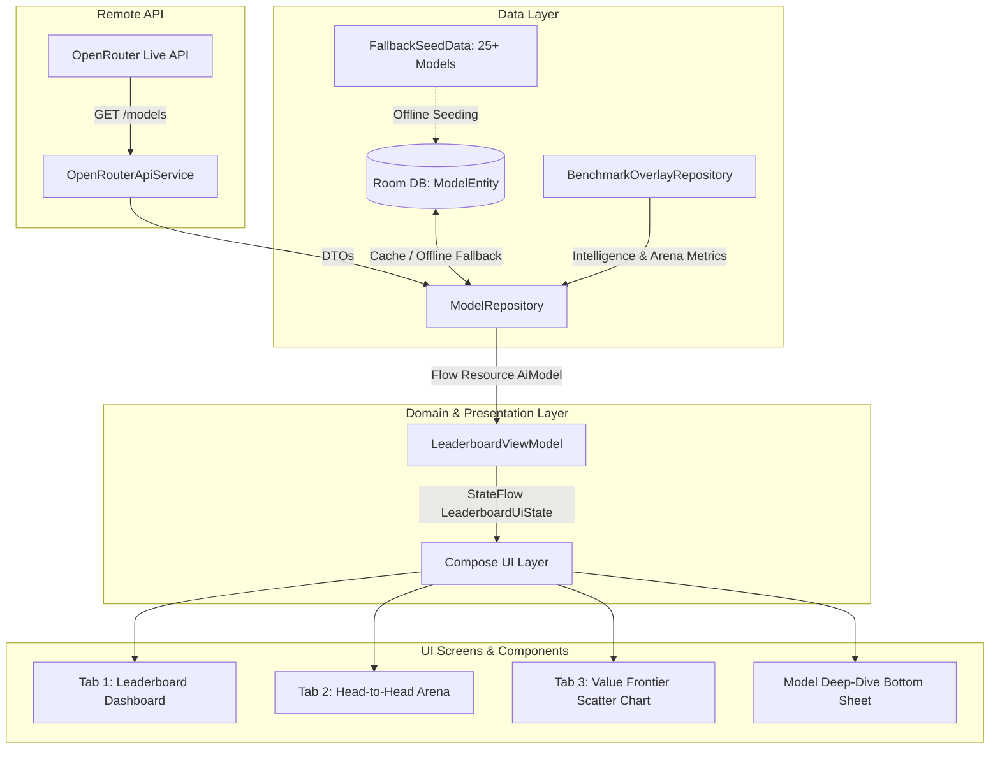

# PulseAI: Live Model Leaderboard ⚡

[](https://github.com/aucksy/pulse-ai-leaderboard/actions/workflows/android-ci.yml)
[](https://developer.android.com)
[](https://kotlinlang.org)
[](https://developer.android.com/jetpack/compose)
[](https://m3.material.io)

**PulseAI** is a high-craft, production-grade native Android application engineered to track frontier AI model leaderboards, real-time throughput metrics, competitive pricing, and multi-metric capability benchmarks with zero human configuration required.

Designed with a **Dark-First "Bloomberg Terminal meets Linear"** aesthetic (`#090D16` deep obsidian, glassmorphic cards, `#6366F1` electric indigo, `#10B981` emerald, `#F59E0B` amber rank crowns).

---

## 🏛️ Architecture & System Design

PulseAI follows **Modern Android Architecture (MVI / Clean MVVM)** with unidirectional data flow (UDF) powered by Kotlin Coroutines & `StateFlow`.



---

## ✨ Key Features & Crafts

### 1. Live Pulse Dashboard (Leaderboard)
- **Top 3 Podium Header**: Glowing cards for the top 3 frontier models with an infinite subtle shimmer/pulse on the #1 crown.
- **Spring-Animated Category Chips**: Filter effortlessly between *Overall Intelligence*, *Coding Kings*, *Reasoning & System-2*, *Best Value (Score/$)*, *Fastest Throughput*, *1M+ Context*, and *Open-Weight vs. Proprietary*.
- **Instant Search & Sort**: Real-time multi-field search and sort toggles (Score, Price, Speed, Context, Value Index).
- **Fluid Gliding Rows**: Built with `Modifier.animateItem()` so items visibly and smoothly glide into place when filters or sorts change.

### 2. Model Deep-Dive & Capability Radar
- **Canvas Radar / Spider Chart**: 5-axis capability diagram (Coding, Reasoning, Agentic, Speed, Value) comparing any model against the category average in real time.
- **Interactive Token Spend Calculator**: Smooth slider (1M to 100M monthly tokens) with reactive animated dollar spending (`AnimatedContent`).
- **Capability Tags**: Tool Calling, Reasoning/Thinking, Vision, and Autonomous Agentic badges.

### 3. Head-to-Head Arena Comparator
- Side-by-side battle between any two frontier models.
- Synchronized animated dual-bars with emerald green winner highlights across Intelligence, Coding, Reasoning, Agentic, Speed, Context Window, Input Cost, and Output Cost.

### 4. Value Frontier Curve (Scatter Plot)
- Custom Jetpack Compose `Canvas` scatter plot mapping **Cost per 1M Tokens (X-axis)** vs. **Intelligence Score (Y-axis)**.
- Real-time Pareto-optimal boundary visualization highlighting frontier models that deliver maximum performance per dollar.

---

## 🛠️ Tech Stack & Verified Dependencies

| Component | Library / Version | Purpose |
|---|---|---|
| **Language** | Kotlin 2.0.21 | Modern functional programming & coroutines |
| **Build System** | AGP 8.7.3 / Gradle 8.10.2 | Android Gradle Plugin & build tools |
| **Compiler Plugin** | Jetpack Compose Compiler 2.0.21 | Declarative reactive UI rendering |
| **Design System** | Material 3 (BOM 2024.11.00) | Expressive obsidian design system |
| **Networking** | Retrofit 2.11.0 + OkHttp 4.12.0 | High-performance HTTP client |
| **Serialization** | Kotlinx Serialization 1.7.3 | Reflection-free JSON parsing |
| **Local Cache** | Room Database 2.6.1 + KSP 2.0.21-1.0.28 | Offline-first persistent storage |
| **Testing** | JUnit 4, Kotlinx Coroutines Test, Turbine | Unit tests & reactive StateFlow testing |

---

## 🚀 Building & Running

### Requirements
- Android SDK 35 (compile & target)
- Minimum SDK: Android 8.0 (API 26)
- Java 17 (Temurin recommended)

### Build Commands
```bash
# Run unit test suite
gradle testDebugUnitTest

# Run Android Lint analysis
gradle lintDebug

# Build debug APK
gradle assembleDebug
```

The resulting debug APK is generated at:
`app/build/outputs/apk/debug/app-debug.apk`

---

## 🧪 Automated CI/CD Pipeline
PulseAI includes a verified GitHub Actions pipeline (`.github/workflows/android-ci.yml`) that executes on every push and pull request to `main`:
1. Checks out repository and configures Temurin JDK 17.
2. Bootstraps Gradle 8.10.2 via `gradle/actions/setup-gradle@v4`.
3. Runs all unit tests (`gradle testDebugUnitTest`).
4. Executes lint checks (`gradle lintDebug`).
5. Assembles debug APK (`gradle assembleDebug`).
6. Publishes the ready-to-install `PulseAI-Debug-APK` artifact.
